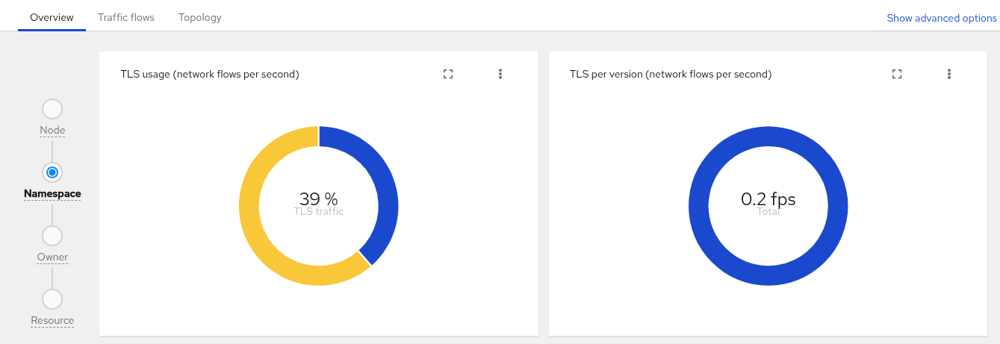
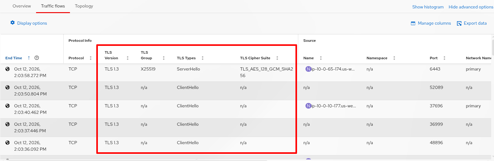
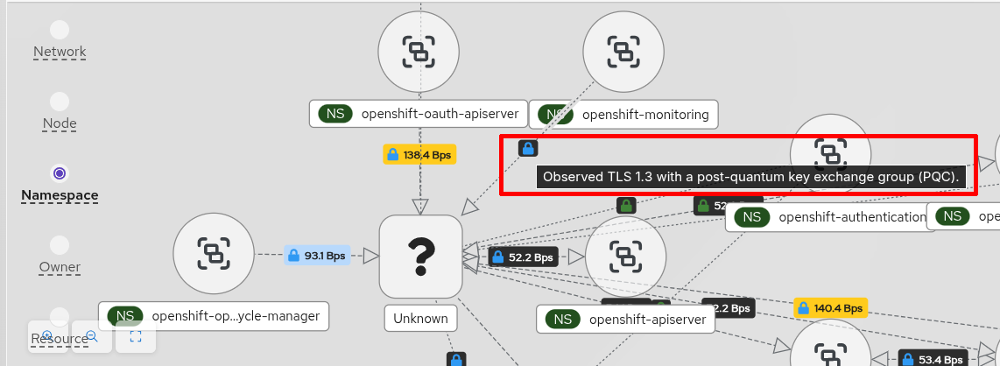

Network observability is an optional operator for OpenShift web console that provides insights to your network traffic and helps with troubleshooting. With release 1.12, it aligns with [Red Hat OpenShift Container Platform (OCP) 4.22](https://docs.redhat.com/en/documentation/openshift_container_platform/4.22) and is backwards-compatible to 4.14. There is also an upstream version, but this article focuses on using OpenShift.

At its core, network observability uses Extended Berkeley Packet Filter (eBPF) agent to collect and aggregate network flow data. A flowlogs-pipeline (FLP) component processes and enriches the data with Kubernetes metadata, such as its pod name and namespace. They are stored as Loki logs and Prometheus metrics. When you install the operator, it adds a UI plugin to OpenShift that provides visualization in the form of graphs, a flow table, and a topology view.

To try out the features in this version, you will need an OpenShift cluster and access to the `oc` command line. Start by following the instructions to [install the network observability operator](https://docs.redhat.com/en/documentation/openshift_container_platform/4.22/html/network_observability/installing-network-observability-operators). For an overview of features and the list of issues fixed, see the [release notes](https://docs.redhat.com/en/documentation/openshift_container_platform/4.22/observability/network_observability).

Here is the list of items that will be covered:

- Security improvements
    - TLS tracking
    - Secure communications between eBPF agent and FLP

- Performance improvements
    - Kafka compression
    - FLP shared cache component

- Ease-of-use
    - Automatic secondary network indexing
    - Simplify including predefined metrics

## TLS tracking

Network observability supports a list of networking-related features that are configured at the eBPF level. Because a feature uses CPU and memory, you can pick and choose exactly which features to enable.

In 1.12, a new eBPF feature, TLS tracking, was added. It monitors TLS connections and records information such as the TLS version, cipher suite, cryptographic group (curve), and TLS type. A typical use of this feature is to ensure that your cluster is fully compliant with the organization's security policies. That might mean you only want TLS 1.3 in the network or you might want all traffic to be encrypted.

In OpenShift web console, you can enable this feature when you create a FlowCollector instance. In **Ecosystem > Installed Operators**, click the FlowCollector link on the **Network Observability** row. On the second page of the setup in the **Features** section, enable **TLSTracking**. Alternatively, enter `oc edit flowcollector` and add `TLSTracking` under the `features` section:

```yaml
spec:
  agent:
    ebpf:
      features:
      - TLSTracking
```

Once this is enabled, go to **Observe > Network Traffic**. In the **Overview** tab, there are new TLS graphs (Figure 1).

<br>
Figure 1. The Overview tab has TLS graphs.

In the **Traffic flows** tab, there are new columns for TLS in the table (Figure 2). By default, only the **TLS Version** column is shown (may need to scroll to the right to see it). Click **Show advanced options** and then **Manage columns**. Click the **tls** button to filter on the TLS-related columns.

<br>
Figure 2. These are the TLS columns available in the traffic flows table.

And in the **Topology** tab, you can visualize what traffic is or is not using TLS (Figure 3).

<br>
Figure 3. The topology shows what links use TLS.

## Secure communications between eBPF agent and flowlogs-pipeline

To enhance internal cluster security, network observability introduces a new TLS type parameter for configuring TLS or mutual TLS (mTLS) between the eBPF agents and the flowlogs-pipeline.

By default, this parameter is set to **Auto** for automatic, meaning it uses native OpenShift annotations to secure communication without requiring manual configuration. If this is sufficient for your requirements, you don't need to do anything. Otherwise, set it to **Disabled** or use **Provided** to supply your own certificates.

Here is an example of setting a **Provided** configuration for custom certificates. Enter `oc edit flowcollector` to make these changes:

```yaml
apiVersion: flows.netobserv.io/v1beta2
kind: FlowCollector
metadata:
  name: cluster
spec:
  processor:
    service:
      tlsType: Provided  # Other values: Auto (default), Disabled
      providedCertificates:
        # CA cert used to verify both the client and server certificates
        caFile:
          name: custom-ca-configmap
          type: configmap
          file: ca.crt

        # Certificate that FLP presents to the eBPF agent
        serverCert:
          name: flp-server-cert-secret
          type: secret
          certFile: tls.crt
          certKey: tls.key

        # Certificate that the eBPF agent presents to FLP
        clientCert:
          name: agent-client-cert-secret
          type: secret
          certFile: tls.crt
          certKey: tls.key  # Omit if your client key isn't required by the setup
```

The `certKey` may be omitted if the secret contains both the public certificate and private key.

## Kafka compression

In network observability, Kafka is an optional component that buffers traffic flows generated by the eBPF agent for processing by FLP and is often needed in high-traffic environments. The supported version from Red Hat is Streams for Apache Kafka. In this release, Kafka performance is improved through compression, with support for gzip, Snappy, LZ4, and Zstandard (zstd).

To enable Kafka compression in FLP, enter `oc edit flowcollector` and make these changes. It assumes you already have Kafka configured.

```yaml
spec:
  deploymentModel: Kafka
  kafka:
    compression: gzip
```

FLP can also export flow data to Kafka consumers, with support for compressing the exported data. To do this, edit as follows:

```yaml
spec:
  exporters:
  - kafka:
      compression: gzip
    type: Kafka  # make sure this is capitalized
```

## FLP shared cache component

In large environments, you might notice that your API server (kube-apiserver) becomes sluggish when network observability is started. This is because FLP sends a sudden burst of list and watch requests to the API server while booting up. By introducing a shared cache component for these requests, it drastically flattens these boot-up spikes. This ensures a much smoother deployment and restart cycle without overwhelming the cluster's control plane.

## Automatic secondary network indexing

OpenShift supports secondary networks via the Multus CNI. Secondary networks are commonly used with SR-IOV or with OVN-Kubernetes' User-Defined Networks (UDN) and allows a pod to have multiple interfaces.

Ideally, the packets that go through the secondary interfaces on these networks should also be enriched to identify the pod name, network name, and namespace. Prior to 1.12, FLP created a lookup table for these pods *only* if it matched a network name specified in the `secondaryNetworks` section of your FLP configuration (e.g. test-network-1 and test-network-2 in the listing below). For each `index` defined, it creates a lookup table. On lookup, the MAC lookup table has preference over IP if both are defined.

```yaml
spec:
  agent:
    ebpf:
      privileged: true  # required to access secondary interfaces data
  processor:
    advanced:
      secondaryNetworks:
        - index:
          - IP
          - MAC
          name: test-network-1  # deprecated and ignored in 1.12
        - index:
          - MAC
          name: test-network-2  # deprecated and ignored in 1.12
```

In 1.12, this is simplified by not requiring you to provide the list of network names and keep them up-to-date. It will automatically index all secondary networks. While the configuration still accepts the `name` statement, it is deprecated and ignored. All of the `index` are combined and applied. If you don't define `secondaryNetworks`, it defaults to MAC and IP for the index.

## Simplify including predefined metrics

There is a list of [predefined metrics](https://github.com/netobserv/netobserv-operator/blob/main/docs/Metrics.md#predefined-metrics) that network observability makes available in **Observe > Metrics** by default. Just note that the Prometheus metric name is prefixed with "netobserv_" so for example, the metric *namespace_egress_bytes_total* is referred to as *netobserv_namespace_egress_bytes_total* in **Observe > Metrics**.

Not all predefined metrics are available as Prometheus metrics, so you can include others. If you use `includeList` to do this, it overrides the list of predefined available metrics. In 1.12, use `additionalIncludeList` instead of `includeList` to add to the list instead of replacing it.

```yaml
spec:
  processor:
    metrics:
      additionalIncludeList:  # use this instead of 'includeList'
        - namespace_egress_bytes_total
        - namespace_ingress_bytes_total
```

## Summary

That wraps up the features in network observability 1.12. It's got a little bit of everything from security, performance, and ease-of-use. Several maintenance releases have come out, so make sure you update to the latest. As usual, you can contact us on the [discussion board](https://github.com/netobserv/netobserv-operator/discussions).
