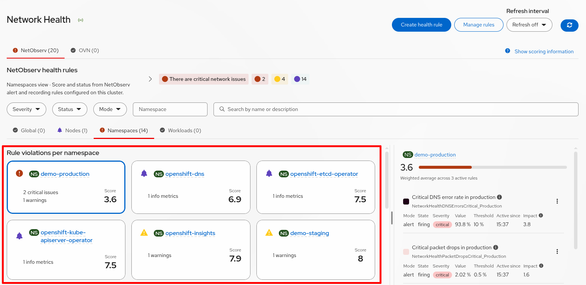
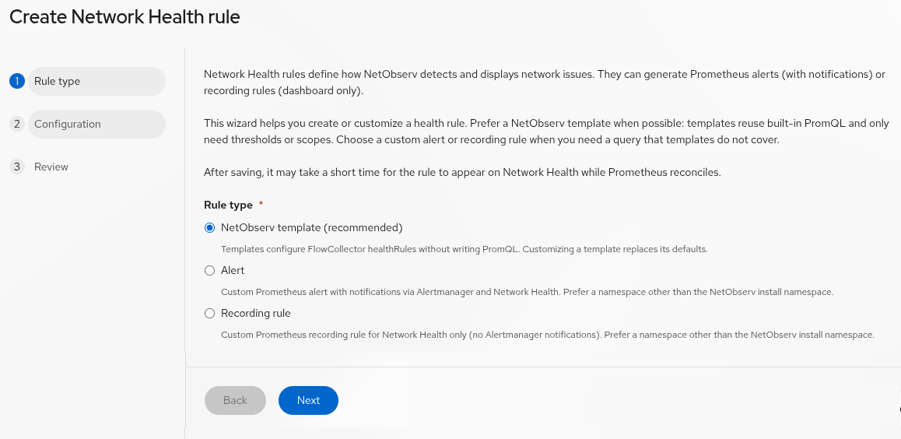
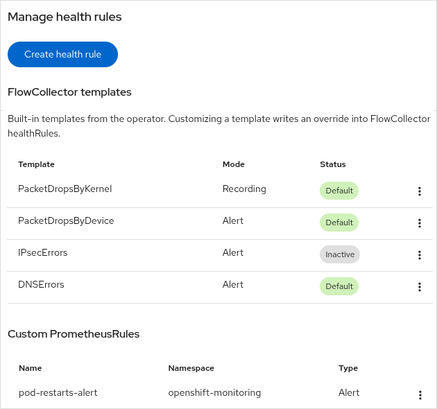
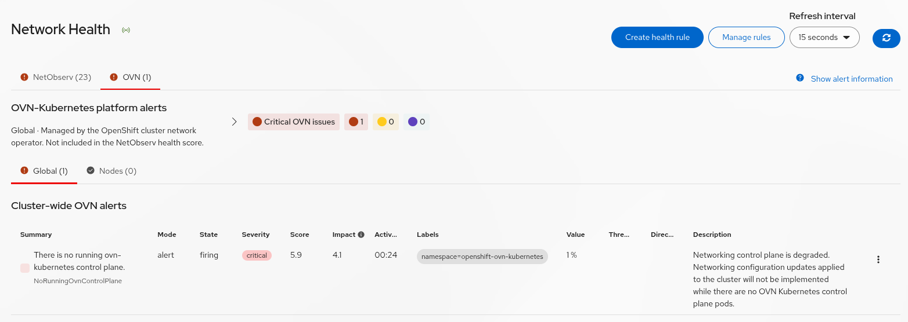
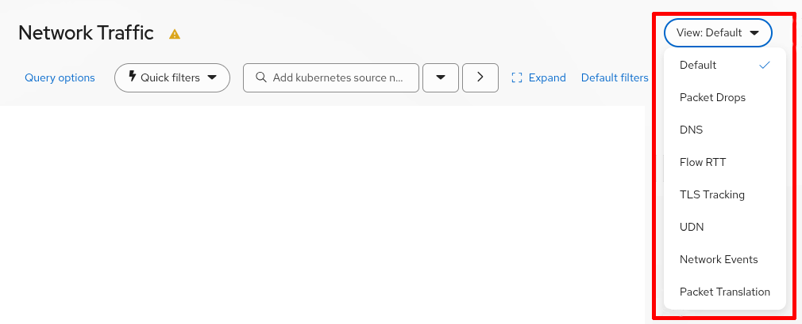
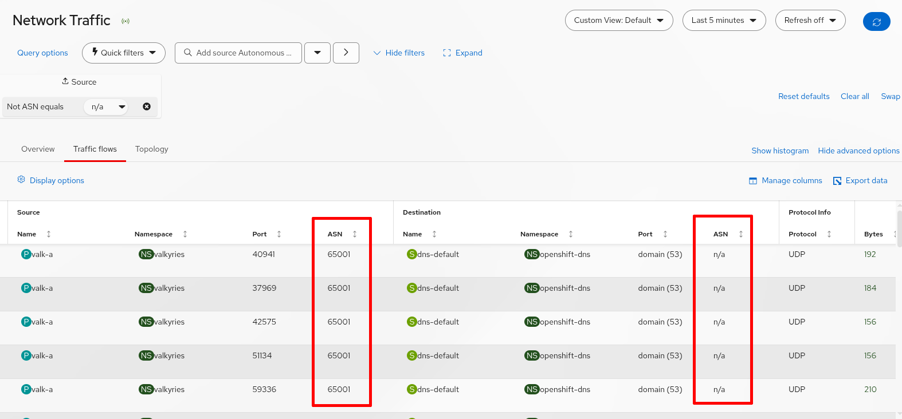

Welcome to another edition of "What's new in network observability". Release 2.0 is now available and aligns with [Red Hat OpenShift Container Platform (OCP) 5.0](https://docs.redhat.com/en/documentation/openshift_container_platform/5.0). Although the major number got bumped up from 1.x to 2.0, it's really just a next release with a new set of features. Despite the release numbering, it remains compatible all the way back to OCP 4.14.

If you're new to network observability, this is an optional operator for Kubernetes and OpenShift to manage your network traffic, provide insights into traffic flows, and help with troubleshooting networking issues. When you [install Network Observability](https://docs.redhat.com/en/documentation/openshift_container_platform/5.0/html/network_observability/installing-network-observability-operators), it deploys the Network Observability Operator (NOO) and defines the FlowCollector CRD. When you create an instance of FlowCollector, it creates the eBPF agent to collect and aggregate network flow data, the flowlogs-pipeline (FLP) pods to enrich the data to include Kubernetes information, and a console plug-in to provide the UI in the OCP web console.

These are the new features in 2.0. To follow along, you need an OpenShift cluster and the `oc` command. Alternatively, you can substitute with a Kubernetes cluster and the `kubectl` command, although some features are OpenShift-specific.

- Network Health dashboard enhancements
- Preconfigured feature views
- Prometheus scrape interval
- Cluster TLS security profile
- Network policies for operator and static plug-in
- Preview features
    - BGP ASN enrichment
    - Informer cache proxy for FLP scalability
    - Enable network observability on day 0

## Network Health dashboard enhancements

### UI dashboard

The Network Health dashboard was first introduced in 1.10 and has evolved into a comprehensive troubleshooting panel that uses the Prometheus alerting and recording rules. What makes it unique is its holistic view of network health from a Kubernetes perspective.

Rather than focus on individual alerts, the dashboard organizes issues into four tabs with these scopes names: Global, Nodes, Namespaces, and Workload (such as pod and deployment). Each card below the tab represents a health issue and displays the number of firing alerts and recording rules whose thresholds have been reached (figure 1). New filter fields were added to filter these cards.

<br>
Figure 1. The Namespaces tab is selected with the cards shown.

Cards are ranked using a health score from 0 to 10, where lower scores indicate poorer health. Select a card to display the details of the health rules on the right-hand side.

### Creating and managing health rules

Network Observability adds Kubernetes metadata in the PrometheusRule objects through the use of annotations. The FlowCollector CRD builds on this capability by introducing a higher-level abstraction called health rules, which support different variants. Each variant generates a set of Prometheus alerting and recording rules underneath the covers. A health rule can optionally be grouped by namespace or node and can define up to three threshold values: critical, warning, and info.

A new UI simplifies health rule creation. Click **Create health rule** to launch the wizard (figure 2).

<br>
Figure 2. This is the first step in the Create Network Health rule wizard.

In Prometheus, a recording rule calculates an expression and stores data in a time series. Network observability ties the recording rules with your threshold values, so it behaves like an alerting rule but doesn't fire an alert and therefore won't cause an alert storm. A common use case is to define recording rules for the info and warning thresholds and an alerting rule for the critical threshold. This lets you track the trends and identify potential problems before an alert is fired.

Network observability has many [predefined health rules](https://github.com/netobserv/netobserv-operator/blob/main/docs/HealthRules.md), many of which are available depending on the eBPF features enabled. A new health rule named 'TLSInsecureVersion' was added in this release to fire a warning alert if it sees more than 5% of traffic using an insecure TLS version. If you want to modify a health rule, such as changing the threshold values, click **Manage rules** (figure 3).

<br>
Figure 3. This is the dialog when you click **Manage rules**.

If you click the vertical ellipsis next to any of the templates, there's a menu item to bring up its runbook. Below the FlowCollector templates, it shows the custom PrometheusRules. The PrometheusRules with the label `netobserv: "true"` are shown here.

### OVN-Kubernetes alerts

If you are running Red Hat OpenShift, there are two tabs at the top: **NetObserv** and **OVN**. Figure 4 shows the OVN-Kubernetes alerts when you are on the **OVN** tab.

<br>
Figure 4. This shows the OVN-Kubernetes alerts.

There are only **Global** and **Nodes** tabs because these are plain Prometheus alerts that do not have the network observability annotations and enrichment data.

In general, Network Health has generic support for creating new tabs dynamically.

## Preconfigured feature views

In the OCP web console, **Observe > Network Traffic**, there's a dropdown to select a view that's based on eBPF features. Figure 5 shows the dropdown when you have all features enabled. By selecting a view, the **Overview** tab shows graphs for that feature and the **Traffic flows** tab includes columns in the table for that feature.

<br>
Figure 5. The dropdown shows the enabled eBPF features.

## Prometheus scrape interval

Prometheus is used to scrape network observability metrics. By default, this happens every 15 seconds. This can now be configured by entering `oc edit flowcollector` with the following:

```yaml
spec:
  processor:
    metrics:
      server:
        scrapeInterval: 60  # seconds
```

## Cluster TLS security profile

TLS is used in many places throughout network observability for component communication, such as when the eBPF agent sends flows to flowlogs-pipeline, when flowlogs-pipeline writes to Loki, and when the console plug-in queries Loki for flow logs or Prometheus for metrics.

Prior to this change, when you enable TLS, it gets the TLS version and other TLS attributes from the version of Golang that was used to compile the component. Now it uses the cluster TLS security profile defined in the APIServer object (apiservers.config.openshift.io). If the profile changes, a TLS profile watcher detects this and automatically restarts the affected pods. This feature works out of the box and needs no configuration. This is an OpenShift-specific feature, so the upstream version will continue to work like before.

## Network policies for operator and static plug-in

Network observability enables network policies on its own components by default (spec.networkPolicy set to `true` in FlowCollector), so that they are locked down and can only communicate with known components. This release adds the network policies for the network observability operator and the network observability static plug-in in the openshift-netobserv-operator namespace.

## Preview features

The remaining three features are preview features, meaning they have not reached general availability and are subject to change.

### BGP ASN enrichment

If you use Border Gateway Protocol (BGP), the flows can be enriched with the source and destination Autonomous System Number (ASN). The ASN is a unique number given to a large network or group of networks, such as a company, university, or an IP provider.

To set up routing and BGP on OpenShift, see [this article](https://developers.redhat.com/articles/2026/01/21/selective-network-hosting-bgp-router-openshift). Assuming you have created a UserDefinedNetwork resource and a couple of pods to talk to each other periodically, enable this feature by entering `oc edit flowcollector` and adding:

```yaml
spec:
  processor:
    bgpEnrichment: true  # add this line
```

In the OCP web console, go to **Observe > Network Traffic**. Select the **Traffic flows** tab. Click **Show advanced options** link and then **Manage columns**.  Select the **Source ASN** and **Destination ASN** columns. You may need to move the columns or remove unused columns to make this visible. Figure 6 shows the traffic flows table with ASN columns.

<br>
Figure 6. This is the traffic flows table showing the ASN columns.

### Informer cache proxy for FLP scalability

In large environments, each FLP instance starts an internal informer at bootup to retrieve Kubernetes data from the API server for flow enrichment. To improve scalability and reduce API server load, an informer cache proxy can be used as a centralized source of cached data. This proxy distributes updates to the FLP processors instead of having each instance independently query the API server.

Here is the minimal configuration to configure an informer cache proxy.

```yaml
spec:
  processor:
    informerCacheProxy:
      enabled: true
      replicas: 2  # minimum is 2, which is the default
```

There are many other parameters that can be configured in the **informerCacheProxy** section.

The listing below shows the network observability pods and services related to informers. There are the new **flowlogs-pipeline-informers-\*** pods and the **flowlogs-pipeline-k8scache** service listening on port 9402.

```text
$ oc get pods -n netobserv
NAME                                           READY   STATUS    RESTARTS   AGE
flowlogs-pipeline-76db9446c7-g9jts             1/1     Running   0          34s
flowlogs-pipeline-76db9446c7-plhsc             1/1     Running   0          23s
flowlogs-pipeline-76db9446c7-zm86r             1/1     Running   0          45s
flowlogs-pipeline-76db9446c7-2d9wg             1/1     Running   0          45s
flowlogs-pipeline-76db9446c7-bkl8p             1/1     Running   0          45s
flowlogs-pipeline-informers-857b898469-55s2m   1/1     Running   0          45s
flowlogs-pipeline-informers-857b898469-6cbbf   1/1     Running   0          45s
netobserv-plugin-f5bfcd475-fbsqk               1/1     Running   0          45s

$ oc get svc -n netobserv
NAME                         TYPE        CLUSTER-IP       EXTERNAL-IP   PORT(S)    AGE
flowlogs-pipeline            ClusterIP   172.30.34.36     <none>        2055/TCP   9h
flowlogs-pipeline-k8scache   ClusterIP   172.30.169.27    <none>        9402/TCP   106m
flowlogs-pipeline-prom       ClusterIP   172.30.250.136   <none>        9401/TCP   9h
netobserv-plugin             ClusterIP   172.30.46.254    <none>        9001/TCP   9h
netobserv-plugin-metrics     ClusterIP   172.30.22.150    <none>        9002/TCP   9h
```

### Enable network observability on day 0

Networking is critical infrastructure, and without network observability, you're essentially flying blind. As AI agents become more autonomous, the risk of unintended or rogue behavior increases. Visibility into network traffic is essential for detecting suspicious activity, containing threats, and preventing security breaches.

#### Enabling network observability in OCP 5.0

In OCP 5.0, network observability can be enabled through a feature gate. To enable the feature gate when creating a cluster with `openshift-install`, add the following to your **install-config.yaml** file:

```yaml
featureSet: CustomNoUpgrade
customNoUpgrade:
  enabled: [NetworkObservabilityInstall]
```

**Important:** The `CustomNoUpgrade` feature set prevents cluster upgrades. Use this configuration only in a test environment.

Single Node OpenShift (SNO) clusters are excluded from the default installation policy. If you want it enabled even for SNO clusters, add the following to your **install-config.yaml** file:

```yaml
networking:
  networkObservability:
    installationPolicy: InstallAndEnable
```

#### Verifying the installation

Once the cluster is up and running, network observability should be installed with a basic FlowCollector instance. If you don't see network observability, enter the following and check the status condition for network observability:

`oc describe network.operator -n openshift-network-operator`

You can also inspect the Cluster Network Operator (CNO) logs for the observability controller:

`oc logs deployment/network-operator -n openshift-network-operator | grep observability_controller`

#### Default FlowCollector configuration

The FlowCollector instance is intentionally configured to use minimal resources:

- **Deployment model:** service model with three FLP replicas
- **Sampling interval:** 400 (1 out of 400 packets)
- **DNS tracking:** enabled
- **Loki:** not configured

Because Loki is not configured, flow logs are not stored, and the traffic flows table is unavailable.

The installation follows the same approach used by the OCP web console. You can modify the FlowCollector configuration as usual, including adding Loki. The lifecycle management of network observability and all its components remains unchanged. It won't reinstall if network observability is removed.

## Conclusion

Release 2.0 brings significant enhancements to the Network Health dashboard, which continues to evolve. We welcome your feedback and suggestions on the [discussion board](https://github.com/netobserv/netobserv-operator/discussions). This release also includes smaller UI, performance, and security improvements. Finally, if you get the chance to try out the preview features, you can help shape their development before they become generally available. See you in the next release!
